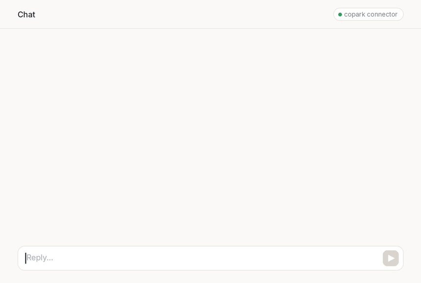
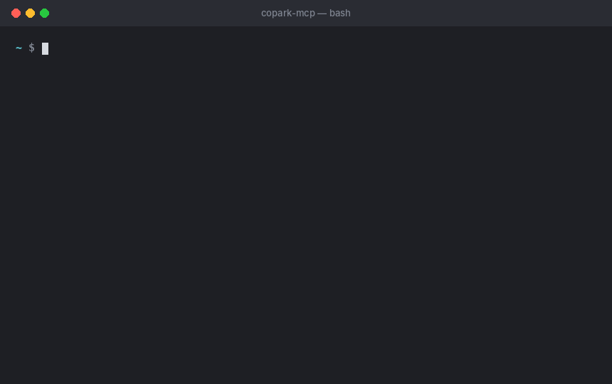

# copark-mcp

Unofficial MCP server and CLI for **CoPark guest parking permits** (gæstetilladelser).

[CoPark](https://copark.dk) only offers an app and a web portal for ordering guest permits.
This project talks to the same API as the web portal, so you can order permits from Claude or any
other MCP client, check your history, or book them on a schedule from cron. Useful if you have
a gardener, a dog walker or anyone else who visits on a regular basis.



> Not affiliated with CoPark or Giant Leap. The API is undocumented and may change without notice.

## What it can do

| MCP tool | CLI | What it does |
|---|---|---|
| `order_guest_permit(plate_or_name)` | `copark-mcp order gardener` | Orders a guest permit, starting now, for a plate or a saved name |
| `save_plate(name, plate, aliases)` | `copark-mcp save gardener AB12345 havemanden` | Saves a plate under a name, checks it against the vehicle register |
| `list_saved_plates()` | `copark-mcp plates` | Saved plates with names, aliases and car descriptions |
| `remove_saved_plate(name)` | `copark-mcp forget gardener` | Deletes a saved plate |
| `list_permits()` | `copark-mcp list` | Currently active permits |
| `permit_history(limit)` | `copark-mcp history 20` | Past guest permits, newest first |
| `guest_permit_usage(months)` | `copark-mcp usage` | Guest permits per month and per plate (with saved names), plus how many are left if you set a monthly limit |
| `lookup_plate(plate)` | | Car description for a Danish plate |
| `list_products()` | `copark-mcp products` | Permit products on your account |

Your guest permit product is found automatically. If your account has more than one (for example
2-hour and 24-hour permits), set `COPARK_GUEST_PRODUCT_ID` to the one you want; `copark-mcp products`
lists them.

## Saved plates

Save the plates you use often under a name, then order by name:

```bash
copark-mcp save gardener AB12345 havemanden
copark-mcp save "dog walker" CD67890 hundelufteren
copark-mcp order gardener
```

From Claude, just say "save the dog walker's plate, CD67890" and later "our dog sitter is coming today,
sort out parking". The model finds "dog walker" in the saved list even though the wording differs;
aliases are only needed for the CLI or for names the model couldn't guess.
The server matches names and aliases exactly (ignoring case); the tool descriptions tell the model
to check the saved list and map looser wording to the right name, and to ask when it's unsure.
If a name isn't found, the error lists the saved names so the model can pick the right one.



Saved plates live in `~/.config/copark-mcp/plates.json` on the machine running the server,
never in the repository. History and usage are labelled with saved names.

## Requirements

- A CoPark account that can order guest permits on the web portal,
  [copark-permit.giantleap.no](https://copark-permit.giantleap.no/user/login), with a password.
  If you don't have a password, use "Glemt adgangskode" on that page.
- The first time you order on the web, CoPark may ask for your name, email and address. Order one
  permit through the web portal by hand first so those are saved to your profile.
- Python 3.10+ and [uv](https://docs.astral.sh/uv/) (or pip).

## Install

```bash
uv tool install git+https://github.com/dromi/copark-mcp
copark-mcp setup
```

`setup` asks for your CoPark login (your mobile number; Danish numbers as 8 digits, other
countries with a country code like `+46`) and, optionally, how many guest permits your association
allows per month. It writes them to `~/.config/copark-mcp/env` (permissions 600) on that machine,
tests the login and finds your guest product. Nothing is stored in the repository. Run `setup`
again to change anything.

Check it works:

```bash
copark-mcp list
copark-mcp usage
```

You can skip `setup` and use environment variables instead; they take precedence over the file.
See [`env.example`](env.example) for all settings.

## Use it from an MCP client

**Local (stdio)**, e.g. Claude Desktop or Claude Code:

```json
{
  "mcpServers": {
    "copark": { "command": "copark-mcp" }
  }
}
```

**On a server (HTTP).** `copark-mcp --http 8766` serves streamable HTTP on `127.0.0.1:8766`.
To run it as a service, see [`deploy/copark-mcp.service`](deploy/copark-mcp.service):

```bash
cp deploy/copark-mcp.service ~/.config/systemd/user/
systemctl --user daemon-reload && systemctl --user enable --now copark-mcp
loginctl enable-linger "$USER"
```

The server has no authentication of its own. Keep it on localhost or your LAN, or put it behind a
proxy that adds auth. If you need to reach it from the internet (for example to add it as a
custom connector in Claude), `setup` gives it a long random URL path (`COPARK_MCP_PATH`), which
works as a shared secret. Claude's custom connectors don't accept URLs with a port number, so
serve it on the default HTTPS port. With Tailscale Funnel, mount it under its secret path (this
coexists with anything else you serve on the same machine):

```bash
P=$(grep COPARK_MCP_PATH ~/.config/copark-mcp/env | cut -d= -f2)
tailscale funnel --bg --set-path "$P" "http://127.0.0.1:8766$P"
# connector URL: https://<machine>.<tailnet>.ts.net<COPARK_MCP_PATH>
```

Set `COPARK_MCP_ALLOWED_HOSTS` (asked by `setup`) to that public hostname, e.g.
`machine.tailnet.ts.net`, so the server only answers requests addressed to it. Without it the
host check is off. Behind a proxy, the MCP SDK's default localhost-only check would answer
`421 Invalid Host header`.

## Book permits on a schedule

No LLM is needed for a fixed schedule; cron and the CLI are enough.

```cron
# Every Monday at 07:30
30 7 * * 1  ~/.local/bin/copark-mcp order gardener >> ~/copark.log 2>&1

# Every third Tuesday: cron can't count weeks, so check the ISO week number.
# Change "-eq 0" to 1 or 2 to shift which week it fires.
30 7 * * 2  [ $(( $(date +\%V) \% 3 )) -eq 0 ] && ~/.local/bin/copark-mcp order gardener >> ~/copark.log 2>&1
```

## Limitations

- **Permits start immediately.** CoPark doesn't support future start dates for guest permits
  (a future start is echoed back, but the end is still counted from now), so order on the day.
- **Password login only.** If CoPark requires SMS verification for your account, login fails with a
  clear message. The SMS endpoints are listed below if someone wants to add that.
- **Monthly limits aren't exposed by CoPark.** Limits are set by each housing association and
  don't appear in the API, so set `COPARK_MONTHLY_LIMIT` yourself to track what's left.
- **Free permits only by default.** Ordering refuses products that cost money unless
  `COPARK_ALLOW_PAID=1`.
- No cancel command yet.

## Development

```bash
uv venv && uv pip install -e '.[dev]'
pytest
```

The tests run offline against a mocked API.

### API notes

CoPark is a white label of Giant Leap's Parko platform. Base URL
`https://copark-permit.giantleap.no/api/`; every call sends `X-GLTLocale: da_DK_copark`, and
authenticated calls send `X-Token: <token>`.

| Call | Purpose |
|---|---|
| `POST public/user/authenticate.json` `{userName, password}` | Login, returns `token` |
| `POST public/user/request-login-sms-otp.json`, `authenticate-sms-otp.json` `{userName, code}` | SMS login (not implemented) |
| `GET public/user/product/permission/facilities.json` | Parking areas on the account |
| `GET public/user/product/permission/facility/{id}.json` | Products in an area |
| `POST public/user/product/permission/request-order.json` `{productId, startTime}` | Price quote |
| `POST user/product/permission/place_order.action` + `X-GLT-IDEMPOTENCY-KEY` | Place the order (body: `productId`, `plateNumbers`, `priceCents`, `firstTermPriceCents`, `startTime`, `acceptedTermsAndConditionsId`, `qualificationForm`) |
| `GET user/purchase/activehistory.json` | Active permits |
| `GET user/agreement/report.json?pageIndex=&pageSize=` | Full history, paged |
| `GET public/user/platenumber/lookup/{plate}.json` | Plate lookup |
| `user/parking/agreement/{id}/terminate.json` | Cancel (seen in the web app, untested) |

## License

MIT
